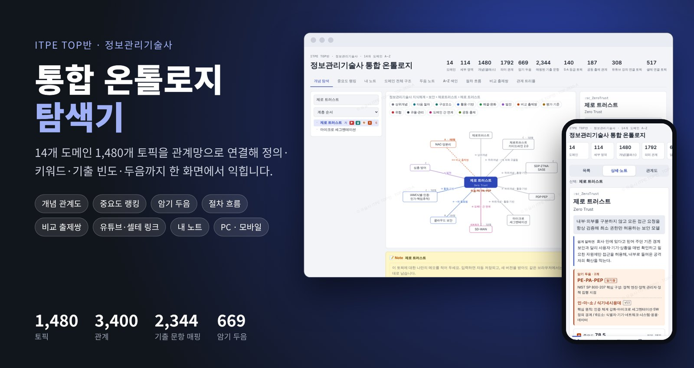
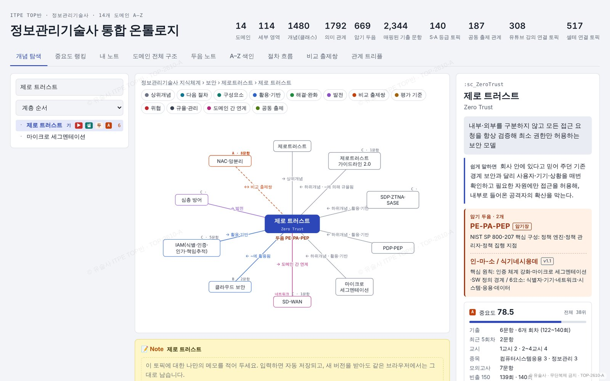
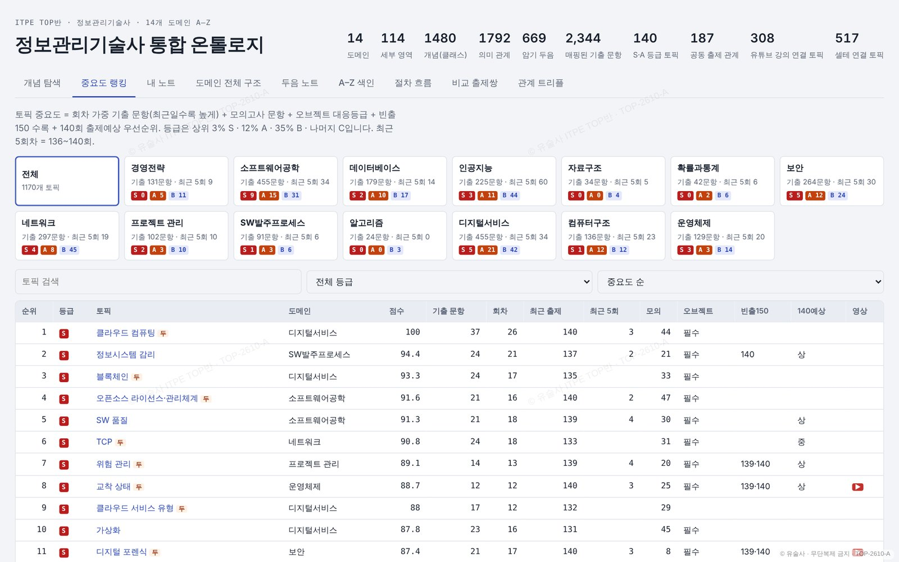
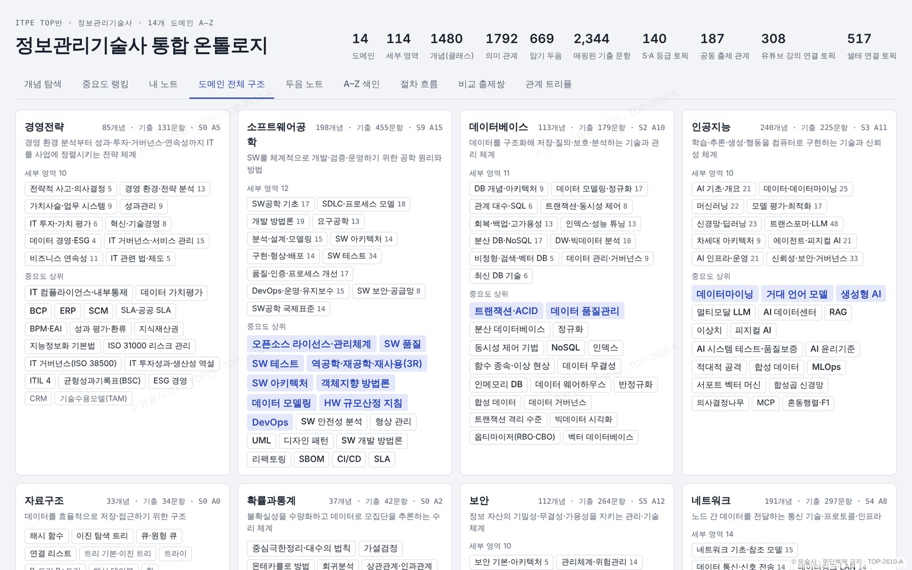
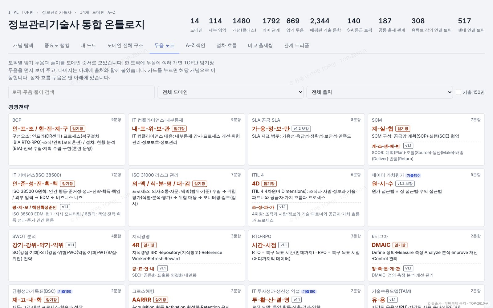
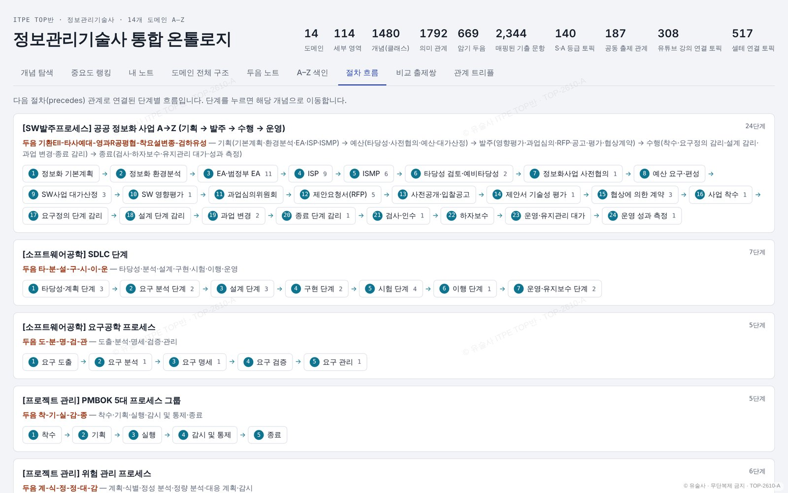
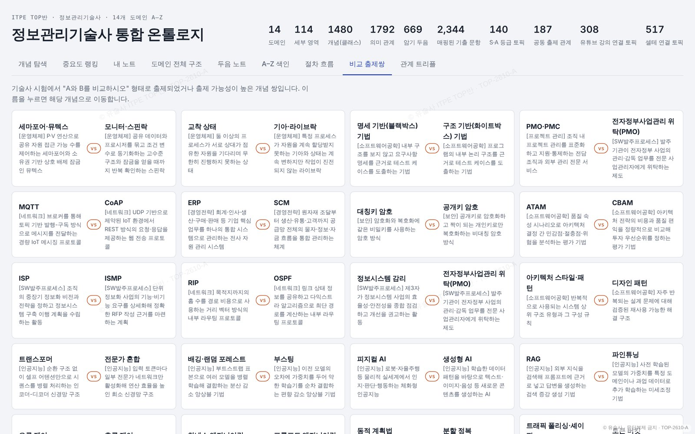
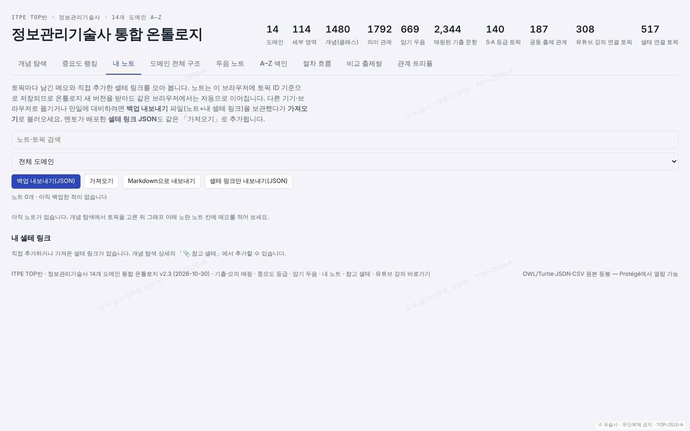
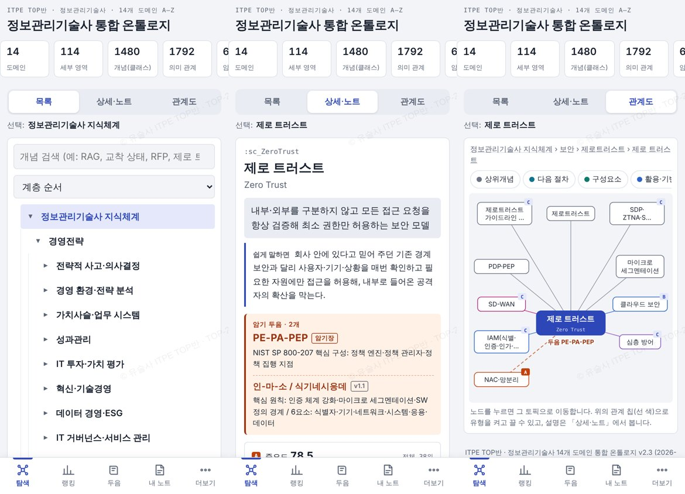

  

<h1 align="center">ITPE 통합 온톨로지 탐색기</h1>

  <b>정보관리기술사 14개 도메인 · 1,480개 토픽을 하나의 지식 관계망으로</b> 
  정의 · 핵심키워드 · 쉬운 설명 · 기출 빈도 · 중요도 · 암기 두음 · 유튜브 강의 · 참고 셀테를 한 화면에서

  <a href="https://pooh8789-hkyou.github.io/itpe-top-ontology/"><b>▶ 바로 사용하기</b></a> ·
  <a href="https://pooh8789-hkyou.github.io/itpe-top-ontology/ontology.html">PC 버전</a> ·
  <a href="https://pooh8789-hkyou.github.io/itpe-top-ontology/ontology-mobile.html">모바일 버전</a> ·
  <a href="data/itpe_ontology.json">데이터(JSON)</a>

---

## Overview

정보관리기술사 시험 범위는 넓고 토픽끼리 서로 얽혀 있습니다. 이 탐색기는 TOP반이 정리한 **14개 도메인 1,480개 토픽**을 상위·하위, 구성요소, 절차, 비교 출제쌍 같은 **관계 3,400개**(계층 관계 + 의미 관계 1,792개)로 연결한 온톨로지입니다. 토픽 하나를 고르면 그 토픽의 정의와 핵심키워드는 물론, 주변 개념, 기출 이력, 암기 두음, 관련 강의까지 함께 보여줍니다.

| 14 | 114 | 1,480 | 1,792 | 669 | 2,344 | 140 | 308 | 517 |
|:-:|:-:|:-:|:-:|:-:|:-:|:-:|:-:|:-:|
| 도메인 | 세부 영역 | 토픽 | 의미 관계 | 암기 두음 | 매핑된 기출 문항 | S·A 등급 토픽 | 유튜브 강의 연결 토픽 | 셀테 연결 토픽 |

**수록 도메인**
- **관리 영역:** 경영전략 · 프로젝트 관리 · SW발주프로세스 · 디지털서비스
- **개발·데이터:** 소프트웨어공학 · 데이터베이스 · 인공지능
- **기초 이론:** 자료구조 · 알고리즘 · 확률과통계
- **시스템·인프라:** 컴퓨터구조 · 운영체제 · 네트워크 · 보안

> v2.4 (2026-10-30) · 기출 데이터 범위: TOP반 기출문제 DB(정보관리·컴퓨터시스템응용·조직응용, ~140회)와 모의고사 문항

---

## 주요 기능

### 1. 개념 탐색: 관계도 + 상세 카드

- **트리와 검색:** 왼쪽 트리에서 도메인 → 세부 영역 → 토픽 순으로 찾아 들어가거나 바로 검색합니다(예: RAG, 교착 상태, RFP).
  - 정렬 기준: 계층 순서, 중요도 순, 기출 문항 많은 순, 최근 출제 순
- **관계도:** 가운데에서 고른 토픽 주변의 개념이 관계 유형별 색으로 그려집니다. 노드를 누르면 그 토픽으로 이동합니다.
  - 관계 유형 12종: 상위개념 · 다음 절차 · 구성요소 · 활용·기반 · 해결·완화 · 발전 · 비교 출제쌍 · 평가 기준 · 위협 · 규율·관리 · 도메인 간 연계 · 공동 출제
- **상세 카드:** 오른쪽에 다음 내용을 한꺼번에 보여줍니다.
  - **정의**: 40자 내외, 명사형 종결로 답안에 바로 옮겨 쓸 수 있는 형태
  - **쉽게 말하면**: 1~2문장의 쉬운 설명
  - **암기 두음**: 토픽 하나에 여러 개가 있을 수 있음
  - **중요도와 기출 이력**: 기출 문항 수, 출제 회차, 교시, 종목, 모의고사, 빈출 150 여부
  - **바로가기**: 유튜브 강의와 참고 셀테
  - **핵심키워드**
- **트리 배지:** 기(기출) · ▶(강의) · 셀(셀테) · 두(두음) · 등급(S/A/B/C)을 표시해, 목록에서도 토픽의 상태를 한눈에 알 수 있습니다.

### 2. 중요도 랭킹

- **점수 구성:** 다음 다섯 가지를 합쳐 0~100점으로 환산합니다.
  - 회차 가중 기출(최근 회차일수록 높은 가중치)
  - 모의고사 출제
  - 오브젝트 대응 등급
  - 빈출 150 포함 여부
  - 140회 출제예상 우선순위
- **등급:** 상위 3%는 **S**, 그다음 12%는 **A**, 35%는 **B**, 나머지는 **C**입니다.
- **도메인별 보기:** 도메인마다 S/A 토픽 수와 최근 5회 출제 수를 카드로 보여주고, 등급·도메인별로 걸러 볼 수 있습니다.

### 3. 도메인 전체 구조

- 14개 도메인의 세부 영역과 토픽을 한 화면에 펼쳐 봅니다.
- 도메인마다 토픽 수, 기출 문항 수, S·A 등급 수를 함께 표시합니다.
- 중요 토픽은 강조 색으로 표시해, 어디에 집중해야 하는지 바로 보입니다.

### 4. 두음 노트

- 669개 암기 두음을 도메인 순서대로 모아 봅니다.
- 출처(TOP반 암기장 · 버전)를 표시하고, 같은 토픽의 다른 두음도 함께 비교할 수 있습니다.
- 두음 · 토픽 · 풀이로 검색하고, 도메인과 출처로 걸러 봅니다.

### 5. 절차 흐름

- 공공 정보화 사업, SDLC, 요구공학, PMBOK 등 **단계형 토픽**을 번호가 붙은 흐름으로 보여줍니다.
- 단계마다 두음이 붙어 있어 순서를 외우기 쉽고, 각 단계를 누르면 해당 개념으로 이동합니다.

### 6. 비교 출제쌍

- 기출에서 "A와 B를 비교하시오" 형태로 자주 나오는 짝을 모았습니다(예: 세마포어·뮤텍스, ERP·SCM, 대칭키·공개키).
- 두 토픽의 정의를 나란히 놓고 차이를 짚어볼 수 있습니다.

### 7. 내 노트 · 개인 셀테 링크

- **노트:** 토픽마다 나만의 메모를 남기면 자동 저장되고, 새 버전을 받아도 같은 브라우저에서는 그대로 유지됩니다.
- **셀테 링크:** 내가 찾은 참고 셀테를 토픽에 직접 추가할 수 있습니다.
- **내보내기·가져오기:** 백업(JSON), Markdown 내보내기, 셀테 링크 팩 가져오기를 지원합니다.
  - 기기를 옮기거나 스터디원끼리 공유할 때 씁니다.

### 8. 모바일 세로형

- 목록 / 상세·노트 / 관계도의 3단 전환과 하단 탭바(탐색 · 랭킹 · 두음 · 내 노트 · 더보기)로 출퇴근길에도 볼 수 있습니다.
- 관계도는 휴대폰 화면에 맞춘 세로형 배치로 다시 그립니다.

### 그 밖의 기능
- **A–Z 색인:** 영문·한글 토픽명으로 바로 찾습니다.
- **관계 트리플:** 「주어–관계–목적어」 형태의 3,400개 관계를 표로 보고 검색합니다.
- **유튜브 강의 바로가기:** 308개 토픽에 TOP반 강의 영상 261개(링크 750개)를 연결했습니다.

---

## 사용 방법

| 용도 | 주소 |
|---|---|
| 첫 화면(기기 자동 추천) | https://pooh8789-hkyou.github.io/itpe-top-ontology/ |
| PC 버전 | https://pooh8789-hkyou.github.io/itpe-top-ontology/ontology.html |
| 모바일 버전 | https://pooh8789-hkyou.github.io/itpe-top-ontology/ontology-mobile.html |

- 설치나 로그인 없이 브라우저에서 바로 열립니다. 노트와 링크는 **각자의 브라우저에만** 저장됩니다.
- 셀테 링크 팩 가져오기: [`data/itpe_selte_links.json`](data/itpe_selte_links.json)을 내려받아 「내 노트 → 가져오기」를 누릅니다.

## 데이터

| 파일 | 내용 |
|---|---|
| [`data/itpe_ontology.json`](data/itpe_ontology.json) | 토픽 · 관계 · 정의 · 키워드 · 쉬운 설명 · 두음 · 중요도 전체 (v2.4) |
| [`data/itpe_selte_links.json`](data/itpe_selte_links.json) | 참고 셀테 링크 팩 (토픽 517개 · 링크 1,024개) |

## 저작권 · 이용 안내

- © 유술사(유희권) · ITPE TOP반
- 탐색기 화면은 보호 처리된 배포본(복사 방지 · 워터마크 · 사용 기한 2027-04-30)입니다.
- 무단 복제·수정·재배포와 AI 학습·요약 활용을 허락하지 않습니다. 학습 목적의 링크 공유는 환영합니다.
